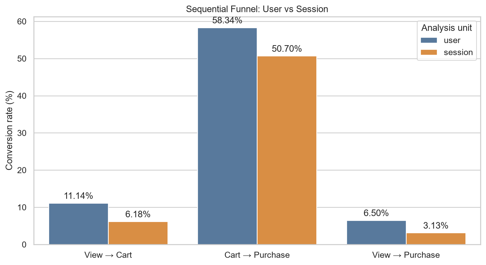
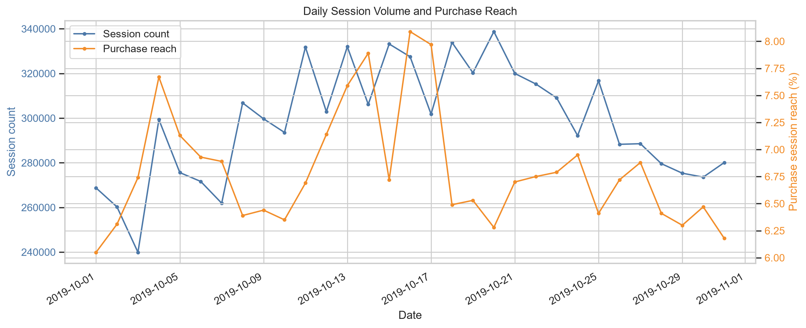
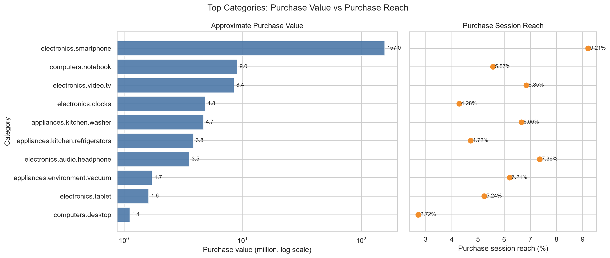
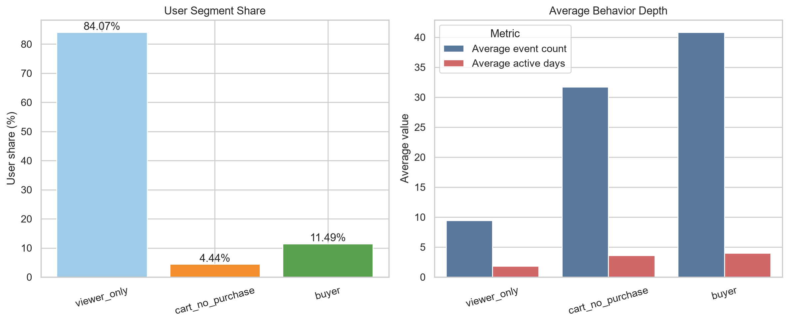
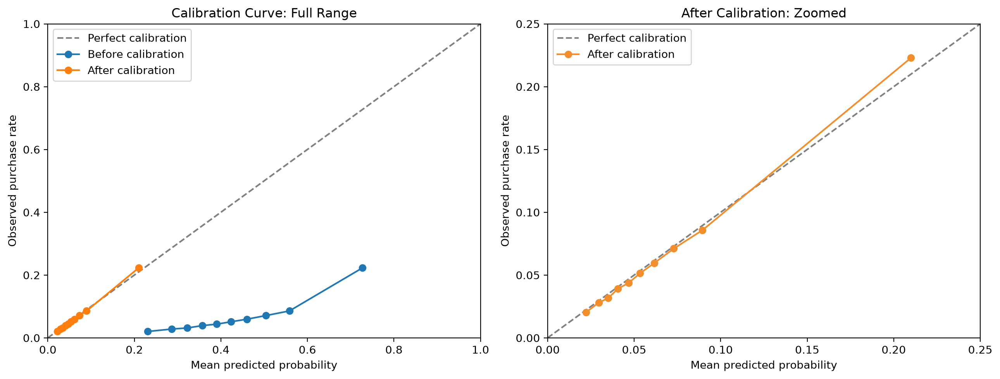

# 电商用户行为分析与购买意向预测

## 项目简介

本项目使用 Kaggle 多品类电商用户行为数据，分析用户从浏览、加购到购买的行为链路，并构建会话级购买意向预测模型。

项目主要回答以下问题：

1. 用户级和会话级转化漏斗表现如何？
2. 哪些日期、品类和价格区间具有更高的购买表现？
3. 哪类用户具有较强购买意向但尚未完成转化？
4. 能否根据会话前 5 次行为预测后续购买？
5. 如何通过 A/B 实验验证模型驱动的推荐策略？

## 项目地址与当前状态

- GitHub 仓库：[Xigema0414/ecommerce-conversion-analysis](https://github.com/Xigema0414/ecommerce-conversion-analysis)
- 本地项目路径：`C:\Users\29443\Documents\实习\项目\ecommerce-conversion`
- Git 分支：`main`
- 当前版本已上传 GitHub，包含 README、4 个 Jupyter Notebook、5 张分析图表、`src/inspect_sample.py`、`requirements.txt` 和 `.gitignore`。
- 原始 CSV、Parquet 中间文件和 `.venv` 未上传，以避免大文件和本地环境文件进入公开仓库。

## 数据来源

数据来源：

[Kaggle Ecommerce Behavior Data from Multi Category Store](https://www.kaggle.com/datasets/mkechinov/ecommerce-behavior-data-from-multi-category-store/data)

本项目使用 `2019-Oct.csv`，数据覆盖：

```text
2019-10-01 00:00:00
至
2019-10-31 23:59:59
```

数据规模：

| 指标 | 数量 |
|---|---:|
| 行为事件 | 42,448,764 |
| 用户 | 3,022,290 |
| 会话 | 9,244,421 |
| 商品 | 166,794 |
| 品类 ID | 624 |

主要字段：

| 字段 | 含义 |
|---|---|
| `event_time` | 行为发生时间 |
| `event_type` | 浏览、加购或购买 |
| `product_id` | 商品 ID |
| `category_id` | 品类 ID |
| `category_code` | 品类名称 |
| `brand` | 品牌 |
| `price` | 商品价格 |
| `user_id` | 用户 ID |
| `user_session` | 会话 ID |

原始数据体积较大，不包含在 Git 仓库中。下载后应放置在：

```text
data/raw/2019-Oct.csv
```

## 技术栈

- Python
- DuckDB
- pandas
- Parquet
- scikit-learn
- LightGBM
- matplotlib
- seaborn
- statsmodels
- Jupyter Notebook

## 项目结构

```text
ecommerce-conversion/
├─ data/
│  ├─ raw/
│  ├─ interim/
│  └─ processed/
├─ notebooks/
│  ├─ 01_data_inspection.ipynb
│  ├─ 02_business_analysis.ipynb
│  ├─ 03_modeling.ipynb
│  └─ 04_ab_test_design.ipynb
├─ reports/
│  └─ figures/
├─ src/
├─ README.md
├─ requirements.txt
└─ .gitignore
```

## 数据处理

### CSV 转换为 Parquet

原始 CSV 大小约为 5.28 GB。为提高查询速度并降低存储占用，使用 DuckDB 将其转换为 ZSTD 压缩的 Parquet 文件，文件大小约为 0.70 GB。

### 缺失值

- `event_time`、`event_type`、`product_id`、`category_id`、`price` 和 `user_id` 没有缺失；
- `category_code` 缺失 13,515,609 条；
- `brand` 缺失 6,113,008 条；
- `user_session` 缺失 2 条。

处理规则：

- 删除两条无法归入会话的记录；
- 缺失的品类名称和品牌统一标记为 `unknown`；
- 原始文件保持不变，所有清洗规则应用于新的 Parquet 文件。

清洗后共有：

```text
42,448,762 条记录
```

### 零价格记录

共有 68,673 条零价格事件，其中：

- 浏览：68,523 条；
- 加购：150 条；
- 购买：0 条。

处理规则：

- 行为和漏斗分析中保留；
- 价格区间分析中单独标记；
- 建模时增加零价格特征。

### 完全重复记录

数据中存在 30,220 条可能多余的完全重复记录，其中大部分为加购行为。

由于数据没有订单 ID 和商品数量字段，无法判断重复记录是日志重复上报，还是用户购买或加购多件同款商品，因此不进行全局删除。

用户级和会话级指标通过 `COUNT(DISTINCT ...)` 避免人数重复计算。

## 业务分析结果

### 用户级与会话级严格漏斗

严格顺序漏斗要求行为按照以下顺序发生：

```text
浏览 → 加购 → 购买
```

| 统计单位 | 浏览后加购率 | 加购后购买率 | 浏览后最终购买率 |
|---|---:|---:|---:|
| 用户 | 11.14% | 58.34% | 6.50% |
| 会话 | 6.18% | 50.70% | 3.13% |

会话级转化率低于用户级转化率，说明部分用户的浏览、加购和购买行为发生在不同会话中。

用户级指标更适合月度用户运营分析，会话级指标更适合评价一次访问的即时转化表现。



### 每日行为表现

每日会话量与购买会话覆盖率并不同步：

- 10 月 20 日附近会话量达到高位，但购买覆盖率相对较低；
- 10 月 16 日购买覆盖率最高，但会话量并非全月最高；
- 月末购买覆盖率出现一定回落。

这说明流量增长不一定对应购买效率提升。

由于数据没有活动、渠道和推荐策略字段，无法确定日期波动的具体原因。



### 品类表现

`electronics.smartphone` 是平台最核心的品类：

- 购买金额近似值约为 1.57 亿；
- 购买会话覆盖率为 9.21%；
- 在浏览、购买事件和金额方面均明显领先。

其他观察：

- `electronics.audio.headphone` 金额规模较小，但购买会话覆盖率达到 7.36%；
- `computers.notebook` 金额贡献较高，但购买会话覆盖率为 5.57%，存在进一步优化空间；
- 高流量、高金额和高购买覆盖率不是完全相同的概念。

购买金额是购买事件中商品价格的加总近似值，不完全等同于真实 GMV。



### 用户分层

按照当月行为将用户划分为：

| 用户群体 | 用户数 | 占比 | 平均事件数 | 平均活跃天数 |
|---|---:|---:|---:|---:|
| 只浏览用户 | 2,540,832 | 84.07% | 9.45 | 1.81 |
| 加购未购买用户 | 134,340 | 4.44% | 31.71 | 3.62 |
| 买家 | 347,118 | 11.49% | 40.83 | 4.02 |

加购未购买用户虽然只占 4.44%，但其行为深度明显高于只浏览用户，并接近买家，是值得重点关注的高意向未转化人群。



### 价格区间表现

不同价格区间的购买表现并不满足“价格越低，购买表现越好”的简单关系。

主要结果：

- `100～300` 价格区间的浏览事件数、购买事件数和购买会话覆盖率均较高；
- `1000+` 价格区间的购买事件数较少，但购买金额贡献最高；
- `50～100` 价格区间具有较大浏览规模，但购买会话覆盖率相对较低；
- 零价格记录没有购买行为。

价格与购买行为之间的关系可能受到品类、品牌和用户偏好的共同影响，因此不能解释为价格对购买的因果影响。

## 购买意向预测

### 预测任务

以 `user_session` 为样本单位：

```text
观察会话前 5 次行为
→ 预测第 5 次行为之后是否购买
```

样本筛选规则：

1. 会话至少包含 5 次行为；
2. 前 5 次行为中尚未购买；
3. 所有模型特征只能来自前 5 次行为；
4. 标签使用第 5 次行为之后是否购买。

最终模型样本：

| 指标 | 数量 |
|---|---:|
| 总样本 | 2,508,382 |
| 正样本 | 178,621 |
| 负样本 | 2,329,761 |
| 正样本比例 | 7.12% |

### 数据切分

为了模拟使用历史数据预测未来会话，采用时间切分：

| 数据集 | 日期 | 样本数 |
|---|---|---:|
| 训练集 | 10 月 1 日—21 日 | 1,729,816 |
| 验证集 | 10 月 22 日—26 日 | 405,672 |
| 测试集 | 10 月 27 日—31 日 | 372,894 |

### 模型特征

最终使用的主要特征包括：

- 会话开始小时和星期；
- 前 5 次行为中的加购次数；
- 不同商品、品类和品牌数量；
- 商品平均价格、最高价格和最低价格；
- 零价格事件数量；
- 前 5 次行为持续时间的对数变换。

为避免特征冗余：

- 删除与加购次数完全互补的浏览次数；
- 持续时间只保留对数变换版本。

### 模型结果

| 模型 | 测试 ROC-AUC | 测试 PR-AUC | Recall@Top 10% | Lift@Top 10% |
|---|---:|---:|---:|---:|
| 逻辑回归 | 0.6935 | 0.2016 | 32.31% | 3.23 |
| LightGBM | 0.7112 | 0.2224 | 34.11% | 3.41 |

LightGBM 整体优于逻辑回归，因此作为最终主模型。

测试集中，LightGBM 预测分数最高的 10% 会话：

- 实际购买率为 22.30%；
- 测试集整体购买率为 6.54%；
- 覆盖 34.11% 的真实后续购买会话；
- 购买率约为整体平均水平的 3.41 倍。

该结果说明模型具有高意向会话筛选价值，但不代表任何推荐策略已经产生因果提升。

### 特征重要性

LightGBM 的 Gain 重要性显示，前 5 次行为中的以下信息具有较高预测贡献：

- 加购次数；
- 不同品类数量；
- 商品最高价格；
- 不同商品数量；
- 会话开始小时。

特征重要性只表示对模型预测的贡献，不代表这些变量对购买具有因果影响。

### 概率校准

由于模型使用 `class_weight="balanced"`，原始预测概率存在明显高估：

| 指标 | 校准前 | 校准后 |
|---|---:|---:|
| 平均预测概率 | 42.61% | 6.62% |
| 测试集实际购买率 | 6.54% | 6.54% |
| Brier Score | 0.1945 | 0.0561 |
| Log Loss | 0.5815 | 0.2169 |
| ROC-AUC | 0.7112 | 0.7112 |
| PR-AUC | 0.2224 | 0.2224 |

使用验证集进行 Sigmoid 校准后，平均预测概率接近实际购买率，且 ROC-AUC 和 PR-AUC 保持不变。



## A/B 实验设计

模型只能识别高购买意向会话，不能证明推荐策略能够提高购买率。

建议在线上对高意向用户测试个性化推荐模块：

- 对照组：维持原策略；
- 实验组：展示个性化商品推荐；
- 随机化单位：`user_id`；
- 核心指标：用户购买转化率；
- 次要指标：加购率、人均购买金额和推荐点击率；
- 护栏指标：退出率、负反馈率、退款率和页面性能。

样本量假设：

- 对照组基线购买率：22.30%；
- 目标相对提升：10%；
- 实验组目标购买率：24.53%；
- 显著性水平：0.05；
- 统计功效：0.80；
- 实验组与对照组 1:1 分流。

计算结果：

- 每组理论样本量：5,658 人；
- 考虑 10% 流失后，每组约 6,287 人；
- 调整后总样本量约 12,574 人。

当前 Kaggle 数据没有实验分组和策略曝光字段，因此这里只提供实验设计，不伪造实验结果。

## 项目局限性

1. 数据只有一个月，无法完整识别长期留存和用户生命周期。
2. `category_code` 和 `brand` 存在较多缺失值。
3. 数据没有订单 ID、商品数量、渠道、设备和活动字段。
4. 购买事件价格之和不完全等同于真实 GMV。
5. 无法完全区分重复日志与购买多件同款商品。
6. 部分购买行为没有对应的当月加购行为。
7. 模型只使用会话前 5 次行为，没有加入用户历史跨会话特征。
8. 特征重要性只表示预测关联，不能解释为因果影响。
9. 模型效果尚未经过真实线上 A/B 实验验证。

## 运行方式

### 1. 创建虚拟环境

```powershell
python -m venv .venv
```

### 2. 安装依赖

```powershell
.\.venv\Scripts\python.exe -m pip install -r requirements.txt
```

### 3. 注册 Jupyter 内核

```powershell
.\.venv\Scripts\python.exe -m ipykernel install --user `
    --name ecommerce-conversion `
    --display-name "Python (ecommerce-conversion)"
```

### 4. 下载数据

从 Kaggle 下载 `2019-Oct.csv`，放到：

```text
data/raw/2019-Oct.csv
```

### 5. 按顺序运行 Notebook

```text
01_data_inspection.ipynb
02_business_analysis.ipynb
03_modeling.ipynb
04_ab_test_design.ipynb
```

运行说明：重启 Jupyter 内核后，需要从上到下重新运行当前 Notebook 中的代码单元；否则前面定义的变量、数据库连接和模型对象不会保留。Notebook 依赖本地生成的 Parquet 文件，必须先完成数据转换和清洗步骤。

## 主要结论

- 用户级严格浏览后购买率为 6.50%，会话级为 3.13%，说明部分行为跨会话完成。
- 手机是规模、金额和购买覆盖率均较高的核心品类。
- 加购未购买用户只占 4.44%，但行为深度接近买家，是重点运营人群。
- LightGBM 测试集 ROC-AUC 为 0.7112，PR-AUC 为 0.2224。
- 模型预测分数最高的 10% 会话覆盖 34.11% 的后续购买会话，Lift 为 3.41。
- 概率校准后平均预测概率为 6.62%，接近真实购买率 6.54%。
- 模型用于筛选高意向人群，策略的增量效果仍需通过随机 A/B 实验验证。

## 当前完成状态

- ✅ 下载并检查 Kaggle 原始数据
- ✅ CSV 转换为 Parquet
- ✅ 数据质量检查
- ✅ 缺失值和异常价格处理
- ✅ 重复记录分析
- ✅ 用户级和会话级严格漏斗
- ✅ 每日行为趋势分析
- ✅ 品类和价格区间分析
- ✅ 用户行为分层
- ✅ 逻辑回归基线模型
- ✅ LightGBM 购买意向模型
- ✅ 时间外测试
- ✅ Top 10% Lift 评估
- ✅ 概率校准
- ✅ A/B 实验设计
- ✅ 业务分析图表
- ✅ 整理项目 README 与运行说明
- ✅ 创建公开 GitHub 仓库并上传可复现代码、Notebook 和图表

## 后续可扩展内容

- ⬜ 增加更多月份数据，进行跨月份验证
- ⬜ 加入用户历史行为特征
- ⬜ 增加模型解释方法，如 SHAP
- ⬜ 使用真实线上实验验证策略效果
